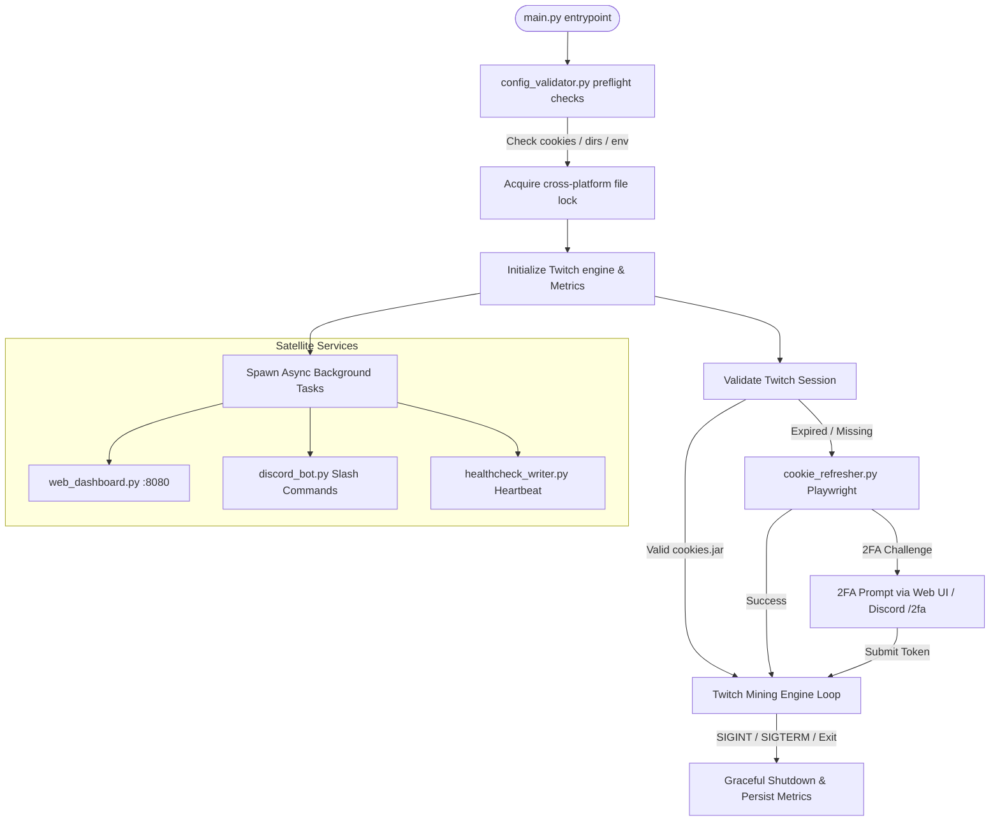
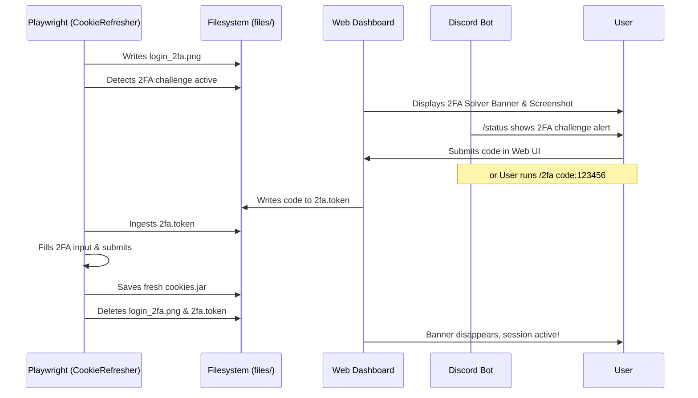

# Twitch Drops Miner — Fork Maintenance & Upstream Sync Guide

This guide documents the architecture of this headless/Docker-optimized fork, provides a comprehensive inventory of custom vs. core modifications, details the satellite subsystems (Web UI, Discord Bot, Cookie Refresher, Healthchecks, Metrics), and gives a step-by-step playbook for future agents and developers to sync upstream updates seamlessly without breaking custom features.

---

## 1. Fork Architecture & Philosophy

### Core vs. Headless Paradigm
The official upstream repository ([DevilXD/TwitchDropsMiner](https://github.com/DevilXD/TwitchDropsMiner)) is designed as a desktop application built around a Tkinter graphical user interface (`gui.py`), Windows registry integration (`registry.py`), desktop icon management (`icons/`), multi-language GUI translations (`translate.py`, `lang/`), and system tray notifications (`pystray`).

This custom fork (`custom/docker-headless-review`) transforms the application into an autonomous, 24/7 headless daemon optimized for Docker containers, NAS servers (Synology, Unraid, TrueNAS), and headless Linux/Windows environments.

### The Decoupling Principle
To make upstream merges and maintenance as friction-free as possible:
1. **Minimize Core File Touches**: Core mining logic files (`channel.py`, `inventory.py`, `twitch.py`, `websocket.py`, `utils.py`, `constants.py`, `settings.py`, `main.py`) only receive changes strictly necessary for headless operation, race condition prevention, containerized network resilience, or upstream bug fixes.
2. **Encapsulate in Satellite Modules**: All extended functionality resides in independent satellite modules (`web_dashboard.py`, `discord_bot.py`, `discord_notifier.py`, `cookie_refresher.py`, `healthcheck.py`, `healthcheck_writer.py`, `metrics.py`, `config_validator.py`). These modules plug into `Twitch` and `main.py` via asynchronous background tasks without altering core mining mechanics.
3. **Delete Desktop GUI Bloat**: Upstream files dedicated solely to desktop GUI (`gui.py`, `translate.py`, `lang/*.json`, `icons/`, `appimage/`, `build.*`, `setup_env.*`, `cache.py`, `registry.py`) are deleted to eliminate desktop dependencies (X11, Tkinter, Pillow, pystray) and drastically reduce container image footprint.

### Headless Daemon Lifecycle


---

## 2. Repository Topology & Branch Layout

| Branch | Purpose | Upstream Relationship |
| :--- | :--- | :--- |
| `master` | Clean mirror of official upstream | Direct 1:1 mirror of `upstream/master`. Never commit custom features here. |
| `custom/docker-headless-review` | Active production headless branch | Contains headless engine, satellite modules, Docker containerization, and synced upstream fixes. |

### Configured Remotes
- `origin`: `https://github.com/LoginRs99/TDM.git` (Fork repository)
- `upstream`: `https://github.com/DevilXD/TwitchDropsMiner.git` (Official upstream)

> [!WARNING]
> **Git Branch Naming Conflict**: Git stores local branch references as files under `.git/refs/heads/`. Because a branch named `custom/docker-headless-review` exists, Git creates a folder named `refs/heads/custom/`. Therefore, Git will disallow creating a branch literally named `custom`. Always use qualified branch names under the `custom/` prefix (e.g. `custom/docker-headless-review`).

---

## 3. Modification Inventory

### A. Core Files (Keep Minimal)

| File | What Was Changed | Why | Upstream Sync Precaution |
| :--- | :--- | :--- | :--- |
| `twitch.py` | • Stripped all Tkinter GUI references (`self.gui`, `LoginForm`, `gui_print`, `gui_close`, `_display()`).<br>• Replaced interactive GUI login with automated cookie session restoration (`cookies.jar`), Playwright auto-refresh (`cookie_refresher.py`), and 2FA token handling.<br>• Integrated `DiscordNotifier`, `HealthcheckWriter`, and `Metrics`.<br>• Added `get_balanced_priority()` algorithm (`PriorityMode.BALANCED`).<br>• Added dynamic cookie file reload watcher (`check_cookies_updated()`).<br>• Resilient handling for `aiohttp.ContentTypeError` and transient GQL dropouts. | Central orchestrator. Headless operation requires automated authentication, metric tracking, and webhook alerts without desktop windows. | **CRITICAL**: Upstream recently added `_browser_login()` using `zendriver` for desktop Chrome login. **DO NOT** import or use `zendriver` / `_browser_login()` or GUI callbacks in `twitch.py`. Keep headless cookie auth, Playwright auto-refresh, and balanced priority intact. |
| `channel.py` | • Removed `self.display()` GUI calls.<br>• Added atomic `stream = self._stream` capture.<br>• Caught `RequestException` in `send_watch()`.<br>• Synced playlist HEAD request mining method (`f693b0c`) with spade fallback. | Prevents GUI crashes, avoids `NoneType` race condition when stream goes offline, and survives transient network drops. | When upstream updates `send_watch()`, preserve the local `stream = self._stream` assignment, `RequestException` try/except block, and spade fallback. |
| `inventory.py` | • Replaced GUI notifications with `logger.info()`.<br>• Stubbed `_on_state_changed()` to `pass`.<br>• Synced zero-delta timer fix (`378697a`). | Headless mode has no Tkinter window or system tray. | Ensure drop claim logging remains in `claim()` and delta bound checks in `_update_real_minutes()` / `update_minutes()` remain intact. |
| `constants.py` | • `LOG_PATH = Path(WORKING_DIR, "logs", "log.txt")`<br>• `PING_TIMEOUT = 30s`<br>• `WATCH_INTERVAL = 20s`<br>• Added `PriorityMode.BALANCED`.<br>• Synced Chrome 156 and Android App 31.8.0 user-agents (`69a4ff9`). | Supports Docker volume mounts (`/logs`), prevents false timeout disconnects on high-latency hosts, and matches upstream HEAD request timing. | Upstream periodically updates User Agents (Chrome, Android App) and GQL query hashes (`GameDirectory`, etc.). These can be safely merged. Retain the `LOG_PATH` subdirectory, `PING_TIMEOUT = 30s`, `WATCH_INTERVAL = 20s`, and `PriorityMode.BALANCED`. |
| `websocket.py` | • Clamped default WebSocket logging to `WARNING` to eliminate reconnect noise.<br>• Resilient exception handling on `ConnectionResetError` and `ClientConnectionError`.<br>• Auto-reconnect trigger on broken pipes. | Prevents unhandled websocket crashes and excessive logging in containerized network environments. | Keep error suppression and auto-reconnect triggers when merging upstream websocket changes. |
| `utils.py` | • Removed `tkinter` and `webbrowser` desktop imports.<br>• Hardened `json_save()` with atomic `.new` rename and Docker bind-mount `EBUSY` / `EXDEV` fallback (`shutil.copyfile`).<br>• Added `is_special = is_special_events` alias.<br>• Maintained cross-platform file locking (`linux`, `darwin`, `win32`). | Prevents headless environments from attempting to load X11/Tk displays and allows settings persistence inside bind-mounted containers. | Do not re-introduce `tkinter` or GUI-dependent imports into `utils.py`. |
| `settings.py` | • Added Docker environment variable overrides (`DISCORD_*`, `WEB_*`, `TWITCH_*`, `PRIORITY_MODE`, `MAINTENANCE_INTERVAL_MINUTES`, `LOGGING_LEVEL`).<br>• Added `discord_notifications_enabled: bool`.<br>• Added 1-week interval parsing (`1w`, `7d`, up to 10080 minutes).<br>• Priority list ranking operations and graceful handling of read-only filesystems. | Allows configuration via `.env` and `docker-compose.yml` without editing JSON files directly. | Keep environment variable loaders, notification toggle fields, and priority list setters intact. |
| `main.py` | • Headless startup banner and configuration preflight validation (`config_validator.py`).<br>• Command-line flags (`--log`, `--dump`, `--login`, `--refresh-cookies`, `--headful`, `-v`).<br>• Added POSIX and Windows signal handling (`SIGINT`, `SIGTERM`) for clean Docker shutdowns.<br>• Spawns Web Dashboard and Discord Bot services in asyncio background tasks.<br>• Multi-handler rotating loggers (`main.log`, `errors.log`, `debug.log`).<br>• Writes metrics on exit. | Replaces Tkinter main loop with server-grade daemon lifecycle. | Upstream changes to `main.py` are rare; when merging, preserve the async services initialization, signal handlers, and lock file mechanism. |
| `requirements.txt` | • Removed GUI/desktop packages (`Pillow`, `pystray`, `zendriver`, `PyGObject`, `pywin32`).<br>• Added headless container packages (`playwright>=1.40.0`, `discord.py>=2.3.0`, `psutil`, `colorama`, `yarl`). | Minimizes image footprint and supports headless Playwright, Discord bot, and metrics. | Never re-add GUI libraries (`Pillow`, `pystray`, `zendriver`) to `requirements.txt`. |

---

### B. Satellite Modules (Custom & Fully Decoupled)

These files do not exist upstream. They can be edited, extended, or refactored freely without causing upstream merge conflicts:

#### 1. `discord_notifier.py` (One-Way Webhook Alerts)
- Sends structured, rich Discord embeds for lifecycle events:
  - 🚀 **Miner Startup**: Displays version, active channels, priority mode, and summary interval.
  - 🎁 **Drop Claimed**: Real-time alert when a timed drop is successfully claimed.
  - ⚠️ **Twitch Session Expired / Logged Out**: Immediate warning if session expires.
  - 🔄 **Twitch Session Restored**: Confirmation when Playwright or cookie reload restores session.
  - 📊 **Periodic Drop Summary & 7-Day Digest (`send_weekly_summary()`)**: Comprehensive mining metrics, drop success rates, watch time, and streamer breakdown.
- Dynamic toggle: `enable()`, `disable()`, `set_enabled()`, and `is_enabled` allow muting webhook alerts without deleting the configured URL.
- Embed styling: Uses Discord Embed Fields (`inline=True`) and color coding (`0x9146FF` Twitch Purple, `0x2ECC71` Green, `0xE74C3C` Red, `0x3498DB` Blue).

#### 2. `discord_bot.py` (Two-Way Interactive Slash Commands)
- Built with `discord.py` application commands and interactive views:
  - `/status`: Interactive status dashboard embed with action buttons:
    - 🔄 **Switch Channel**: Request immediate channel switch.
    - 📦 **Refresh Campaigns**: Trigger drop inventory re-check.
    - 🔐 **Refresh Cookies**: Trigger Playwright headless session refresh.
    - 📋 **Mode Select Dropdown**: Live switch between `BALANCED`, `PRIORITY_ONLY`, `ENDING_SOONEST`, and `LOW_AVBL_FIRST`.
  - `/games`: List active campaigns with priority and exclusion status.
  - `/drops`: Detailed drop progress bars across all active campaigns.
  - `/settings`: Interactive viewer and configuration for miner settings.
  - `/weekly`: View and send the 7-day weekly mining summary.
  - `/2fa <token>`: Submit 2FA verification code to solve Playwright login challenge.
  - `/help`: Overview of all available bot commands.
- **`/priority` Command Group**:
  - `/priority list`: Shows ranked priority list with live mining indicators (`⛏️ Currently Mining`, `🟢 Drops Active`, `⚪ Inactive`).
  - `/priority add <game> [rank]`: Add game or insert at a specific rank position.
  - `/priority move <game> <new_rank>`: Reorder an existing game's rank.
  - `/priority top <game>`: Promote game directly to Rank #1 (highest priority).
  - `/priority remove <game>` & `/priority clear`: Delete entries or clear list.
- **`/exclude` Command Group**:
  - `/exclude list`, `/exclude add <game>`, `/exclude remove <game>`.
- **`/notifications` Command Group**:
  - `/notifications status`, `/notifications enable`, `/notifications disable`, `/notifications interval <mins>`, `/notifications test`, `/notifications weekly`.
- **Security & Resilience**:
  - Supervisor auto-restart loop with exponential backoff protects against gateway disconnects and long network dropouts.
  - Rate-limiting protection: `tree.sync()` is guarded so it only synchronizes commands once on initial startup, preventing Discord 429 bans.
  - Persistent views registered via `bot.add_view(StatusView)` to prevent button interaction failure.
  - Controlled by `DISCORD_OWNER_ID`. If set, only the owner can execute management commands. If empty, falls back to Discord Guild Administrators.
  - Uses `interaction.response.defer(ephemeral=True)` on all state-modifying slash commands to prevent Discord 3-second timeouts.
  - Global `tree.on_error` handler catches and reports interaction exceptions cleanly.
  - Game autocomplete for easy command input.

#### 3. `web_dashboard.py` (Lightweight Web UI & REST API)
- Decoupled `aiohttp.web` service running on port `8080` (or `WEB_PORT`).
- Dark-mode responsive Tailwind CSS UI:
  - Header with RAM consumption badge, miner state badge, uptime counter, and logout button.
  - Live channel card with channel switcher and active drop progress bar.
  - Priority badge indicators (`#1 Priority`, etc.) and campaign ordering by user rank.
  - 1-click Discord Notification Toggle button (`🔔 Discord Alerts: ON/OFF`).
  - Interactive Action Panel: Channel Switch, Refresh Campaigns, Refresh Cookies.
  - **Remote 2FA Challenge Solver**: Displays live 2FA screenshot from Playwright and provides an inline input field to submit verification codes remotely.
- **Security**: Optional password protection via `WEB_PASSWORD`. Supports session cookies (`tdm_auth`) and HTTP Bearer tokens.
- **REST Endpoints**:
  - `GET /`, `GET /login`, `POST /login`, `GET /logout`
  - `GET /api/health`: Container health check endpoint.
  - `GET /api/status`: Real-time JSON status of miner, channels, drops, and metrics.
  - `GET /api/2fa/status`: Whether a 2FA challenge is currently pending.
  - `GET /api/2fa/screenshot`: PNG image of the Twitch 2FA challenge screen.
  - `POST /api/action/submit-2fa`: Submit 2FA token to Playwright.
  - `POST /api/action/switch`: Request stream switch.
  - `POST /api/action/refresh`: Refresh drop inventory.
  - `POST /api/action/refresh-cookies`: Trigger Playwright cookie renewal.
  - `POST /api/action/toggle-notifications`: Toggle Discord webhook alerts.

#### 4. `cookie_refresher.py` (Zero-Touch Playwright Cookie Refresher)
- Automated headless Chromium session refresher using persistent profile directory (`files/browser_profile`).
- Automated login using `TWITCH_USERNAME` and `TWITCH_PASSWORD`.
- Remote 2FA Solver support: captures `files/login_2fa.png` and watches for `files/2fa.token`.
- External cookie format converter: `convert_external_cookies_file()` automatically converts Netscape `cookies.txt` or JSON exports into binary `cookies.jar`.
- Chromium flags optimized for Linux Docker/Portainer environments (`--no-sandbox`, `--disable-dev-shm-usage`, `--disable-gpu`, `--disable-software-rasterizer`).

#### 5. `healthcheck.py`, `healthcheck_writer.py` & `healthcheck.sh` (Container Health Monitoring)
- Dual-layer container health verification:
  1. Queries Web Dashboard HTTP `/api/health` endpoint with dynamic `WEB_PORT` resolution.
  2. Verifies filesystem heartbeat timestamp (`healthcheck.timestamp` age <= 180 seconds).
  3. Monitors consecutive GQL failures (unhealthy if failures >= 3).
- Returns exit code `0` (healthy) or `1` (unhealthy) for Docker daemon and Docker autoheal.

#### 6. `metrics.py` (Runtime Metrics Tracker & Exporter)
- Records total runtime, drop claims, drop claim failures, watch minutes, stream distribution, and error counts.
- Atomically persists metrics to `metrics.json` on disk.
- Generates human-readable summaries on shutdown or request.

#### 7. `config_validator.py` (Startup Preflight Validator)
- Runs before application start to catch configuration and environment problems early.
- Verifies required directories exist and are writable.
- Validates `cookies.jar` binary file integrity (ensuring files < 50 bytes or empty files are rejected) without corrupting binary data with text-mode reads.
- Auto-recovers by converting any `cookies.txt` or `cookies.json` present in `files/`.

#### 8. `test_suite.py` (Automated Parity & Regression Test Suite)
- 23 automated unit and integration tests across 7 test classes:
  - `TestUpstreamSync`: Validates `WATCH_INTERVAL = 20s`, zero-delta drop timer fix (`378697a`), playlist HEAD request mining method (`f693b0c`), and Chrome 156 / Android App 31.8.0 user-agents (`69a4ff9`).
  - `TestDiscordNotifications`: Validates toggle disable/enable, webhook suppression, rich embed layouts, 1-week weekly summary digests, and test notifications.
  - `TestSettingsIntervals`: Validates 1-week interval parsing (`1w`, `7d`, `10080m`) and `DISCORD_NOTIFICATIONS_ENABLED` env parser.
  - `TestDiscordBotCommands`: Validates slash command registrations (`/notifications`, `/weekly`, `/priority`, `/exclude`, `/2fa`), persistent view registration, single-sync guard, and error handler.
  - `TestWebDashboardAndHealthcheck`: Validates Web UI notification toggle, dynamic `WEB_PORT` healthcheck resolution, and network health reporting.
  - `TestNetworkResilienceAndLogging`: Validates `is_network_healthy` property under connection dropouts and verifies inactive game suggestions log at `INFO` level.
  - `TestJsonSaveAndPriorityRanking`: Validates Docker bind-mount `EBUSY` fallback (`shutil.copyfile`) and priority ranking CRUD logic.

---

## 4. Priority Ranking & Mining Algorithms Guide

### Supported Priority Modes (`PRIORITY_MODE`)

| Mode | Value | Behavior |
| :--- | :---: | :--- |
| `BALANCED` | `3` | **(Default & Recommended)** Smart ranking: priority list games first, with automatic scarcity boosts for ACL-limited channels, scarce live streamers, and ending-soon drops. |
| `PRIORITY_ONLY` | `0` | Strictly mines games configured in the user's priority list. If no priority games are active, the miner idles. |
| `ENDING_SOONEST` | `1` | Automatically prioritizes campaigns ending the earliest. |
| `LOW_AVBL_FIRST` | `2` | Prioritizes campaigns with the lowest time availability window. |

### The Balanced Priority Algorithm (`get_balanced_priority()`)
In `twitch.py`, each channel is evaluated using a composite score where **lower score = higher mining priority**:
```python
score = float(priority_names.index(game.name)) if game.name in priority_names else float(len(priority_names) + 2)

# Scarcity Boosts (Deductions reduce score, giving higher priority):
if active_campaign.allowed_channels:
    if len(active_campaign.allowed_channels) <= 1:
        score -= 0.75  # Highly scarce ACL channel
    elif len(active_campaign.allowed_channels) <= 4:
        score -= 0.50

if live_count <= 1:
    score -= 0.75      # Only 1 stream live for this game
elif live_count <= 3:
    score -= 0.50

if active_campaign.availability <= 0.50:
    score -= 0.35      # Short availability window remaining
```

### Managing Priority via Discord Bot & Web UI
- **Discord Bot**:
  - Add game at top: `/priority top game:Rust`
  - Insert game at specific rank: `/priority add game:"Sea of Thieves" rank:2`
  - Reorder existing game: `/priority move game:Rust new_rank:1`
  - List all ranks: `/priority list`
- **Web Dashboard**: Displays `#1 Priority`, `#2 Priority` badges on campaign cards and sorts active campaigns according to user ranking order.

---

## 5. Remote 2FA & Session Management Playbook

When Twitch requests 2FA verification during login, this headless fork provides a zero-desktop workflow:



---

## 6. Step-by-Step Upstream Sync Playbook

Whenever upstream releases new commits, follow this exact procedure:

### Step 1: Fetch Upstream Changes
```bash
git fetch upstream
```

### Step 2: Update Local `master` Mirror
```bash
git checkout master
git merge upstream/master
# master is now a clean 1:1 mirror of upstream/master
```

### Step 3: Inspect Upstream Changes
Check which commits were introduced upstream and what files they modified:
```bash
git log master -n 10 --stat
```
Identify whether upstream modified:
- **Core files** (`channel.py`, `inventory.py`, `constants.py`, `twitch.py`, `websocket.py`, `utils.py`, `settings.py`, `main.py`).
- **Deleted GUI files** (`gui.py`, `translate.py`, `lang/*.json`, `icons/`, `appimage/`). **Ignore these entirely**.

### Step 4: Port Upstream Logic to `custom/docker-headless-review`
Switch to the custom branch:
```bash
git checkout custom/docker-headless-review
```

Depending on upstream changes:
- **Option A (Cherry-pick clean commits)**:
  If an upstream commit only touches core algorithms without referencing GUI or Tkinter:
  ```bash
  git cherry-pick <commit-hash>
  ```
- **Option B (Manual Port / Selective Merge)**:
  If upstream modified core files that mix GUI and mining logic:
  1. Inspect the diff: `git show <commit-hash> -- <filename>`
  2. Apply the core algorithmic logic to the file in `custom/docker-headless-review`.
  3. **Strict Headless Safeguards**:
     - `twitch.py`: **NEVER** import or call `zendriver` or Tkinter `self._twitch.gui`. Retain headless cookie validation, `_try_auto_refresh()`, and `get_balanced_priority()`.
     - `channel.py`: Retain atomic `stream = self._stream` capture and `RequestException` suppression.
     - `inventory.py`: Replace any new `gui` calls with `logger.info()`.
     - `constants.py`: Retain `LOG_PATH` subdirectory, `PING_TIMEOUT = 30s`, `WATCH_INTERVAL = 20s`, and `PriorityMode.BALANCED`. User agents (Chrome, Android App) and GQL query hashes should be synced.
     - `utils.py`: Never re-add `import tkinter` or `import webbrowser`. Retain atomic `.new` rename and `EBUSY` fallback.
     - `requirements.txt`: Never re-add `Pillow`, `pystray`, or `zendriver`.

### Step 5: Run Automated Verification Tests
Always run the complete test suite before committing:
```bash
python test_suite.py
```
**All 18 tests must pass (`OK`)**. If a new upstream feature was ported, add a corresponding test case to `TestUpstreamSync` in `test_suite.py`.

### Step 6: Verify Module Imports
Run an import audit to ensure no missing dependencies or syntax errors exist:
```bash
python -c "import channel, constants, inventory, utils, settings, twitch, main, web_dashboard, discord_notifier, discord_bot, cookie_refresher, metrics, healthcheck, healthcheck_writer, config_validator"
```

### Step 7: Commit and Push
```bash
git add -u
git commit -m "sync(upstream): port <description of change> from <commit-hash>"
git push origin custom/docker-headless-review
```

---

## 7. Docker Integration & CI/CD Guide

### Environment Variables Reference (`.env`)

| Variable | Default | Allowed Values / Format | Purpose |
| :--- | :--- | :--- | :--- |
| `DISCORD_WEBHOOK_URL` | `""` | `https://discord.com/api/webhooks/...` | Discord webhook for claim alerts and periodic digests. |
| `DISCORD_NOTIFICATIONS_ENABLED` | `true` | `true`, `false` | Master toggle to enable/mute webhook alerts. |
| `DISCORD_SUMMARY_INTERVAL` | `60` | `1` to `10080` (or `1w`, `7d`, `24h`) | Frequency of periodic drop progress summaries. |
| `DISCORD_BOT_TOKEN` | `""` | Bot token from Discord Developer Portal | Enables 2-way interactive slash command bot. |
| `DISCORD_OWNER_ID` | `""` | 18-19 digit Discord User ID | Restricts bot control commands to this owner ID. |
| `WEB_DASHBOARD` | `true` | `true`, `false` | Enable or disable the web interface and REST API. |
| `WEB_PORT` | `8080` | Port number (e.g. `8080`, `9000`) | Port on which the web dashboard listens. |
| `WEB_PASSWORD` | `""` | Any string | Optional password protection for web UI & REST API. |
| `AUTO_COOKIE_REFRESH` | `true` | `true`, `false` | Automatically refresh cookies via Playwright. |
| `TWITCH_USERNAME` | `""` | Twitch username | Optional credentials for automated Playwright login. |
| `TWITCH_PASSWORD` | `""` | Twitch password | Optional credentials for automated Playwright login. |
| `PRIORITY_MODE` | `BALANCED` | `BALANCED`, `PRIORITY_ONLY`, `ENDING_SOONEST`, `LOW_AVBL_FIRST` | Mining stream selection strategy. |
| `MAINTENANCE_INTERVAL_MINUTES`| `20` | `5` to `120` | Interval between inventory and campaign refreshes. |
| `LOGGING_LEVEL` | `INFO` | `DEBUG`, `INFO`, `WARNING`, `ERROR` | Console and file logging verbosity. |
| `TZ` | `UTC` | Timezone string (e.g. `Europe/Budapest`) | Container timezone. |

### Docker Volume Mounts
In `docker-compose.yml`, 4 host files/directories are mounted:
- `./files/settings.json:/home/appuser/app/settings.json`: Configuration file.
- `./files/cookies.jar:/home/appuser/app/cookies.jar`: Twitch authentication cookies.
- `./files/logs:/home/appuser/app/logs`: Persistent rotating log files.
- `./files/browser_profile:/home/appuser/app/files/browser_profile`: Persistent Chromium user profile.
- `tmpfs /tmp (50M)`: In-memory temp filesystem for security and performance.

> [!IMPORTANT]
> **Docker Bind-Mount `EBUSY` / `EXDEV` Handling**: On Docker volume bind mounts, standard atomic renames (`os.replace`) can raise `OSError: [Errno 16] Device or resource busy (EBUSY)` or `[Errno 18] Invalid cross-device link (EXDEV)`. In `utils.py`, `json_save()` catches `OSError` and safely falls back to `shutil.copyfile()` with tempfile cleanup to guarantee persistent writes inside Docker.

### Local Container Build & Run
```bash
# Build the container locally:
docker compose build

# Start the container in background:
docker compose up -d

# Force rebuild after modifying code:
docker compose up --build -d

# Check live logs:
docker compose logs -f
```

### GitHub Actions CI/CD (`.github/workflows/docker-image.yml`)
- **Triggers**: Pushes to `main`, `master`, `custom/**`, `codex/**`, semver tags (`v*`), or manual `workflow_dispatch`.
- **Image Publishing**: Builds multi-stage images and publishes to GitHub Container Registry (`ghcr.io/loginrs99/tdm`).
- **Tagging Strategy**: Tags `:latest` on `master` and `custom/docker-headless-review`, branch tags (e.g. `:custom-docker-headless-review`), and `:sha-<hash>`.

---

## 8. Testing & Maintenance Checklist

Before committing, merging, or deploying changes, run through this checklist:

- [ ] **Run Automated Test Suite**:
  ```bash
  python test_suite.py
  ```
  Verify that all **23/23 tests pass** (`OK`).
- [ ] **Run Module Import Audit**:
  ```bash
  python -c "import channel, constants, inventory, utils, settings, twitch, main, web_dashboard, discord_notifier, discord_bot, cookie_refresher, metrics, healthcheck, healthcheck_writer, config_validator"
  ```
- [ ] **Verify No Desktop Dependencies**:
  Ensure that no core or satellite module imports `tkinter`, `PIL.ImageTk`, `webbrowser`, `pystray`, or `zendriver`.
- [ ] **Verify Healthcheck Dual-Layer Monitoring**:
  Verify `healthcheck.py` handles both HTTP check (`WEB_PORT`) and file timestamp check.
- [ ] **Verify Configuration Parity**:
  Verify that any new configuration parameter added to `settings.py` is reflected in `.env.example`, `docker-compose.yml`, and `files/settings.json`.
- [ ] **Verify Docker Build**:
  ```bash
  docker compose build
  ```
